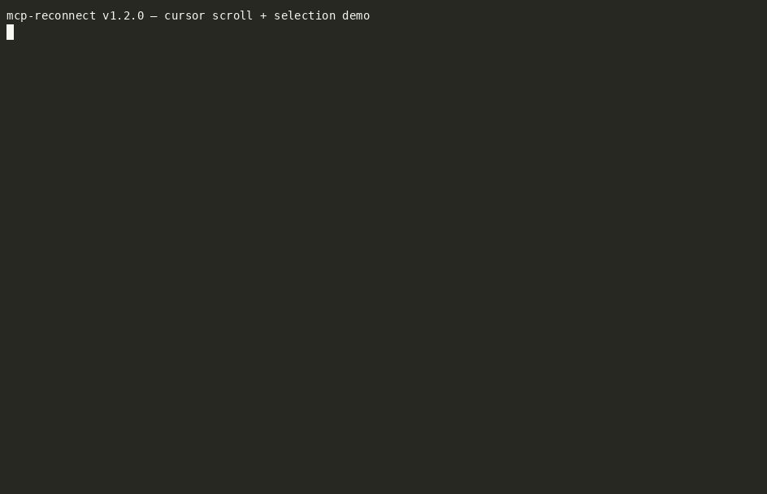

# mcp-reconnect

Automated MCP server reconnection for Claude Code sessions running in tmux.



> *Real demo against Claude Code v2.1.150 — actual `/mcp` menu, actual cursor navigation, actual reconnect. See `demo/README.md` for how to rebuild.*

Current version: v1.2.0

Claude Code has no programmatic API for MCP reconnect — the only way is through the interactive `/mcp` menu. This tool automates that entire sequence via `tmux send-keys`, handling single machines, multi-session environments, and remote hosts over SSH.

## The Problem

**Building MCP servers, you iterate.** Edit the server code, restart the process, switch to your Claude Code session, `/mcp` → arrow down → Enter to reconnect, type the prompt you were working on. Every cycle. This is exactly the loop mcp-reconnect was built for — let the agent reconnect itself so you stay in flow instead of context-switching to drive a menu.

The same pain shows up at fleet scale: deploying new MCP server code or restarting server processes drops the connection on every active Claude Code session. With multiple sessions across multiple machines, manually walking `/mcp` → Reconnect on each one becomes the bottleneck.

mcp-reconnect handles both cases: one session, your session, every session — local or over SSH.

## The Solution

`mcp-reconnect` drives the `/mcp` menu programmatically through tmux:

```
Escape        →  stop active generation
/mcp + Enter  →  submit the /mcp slash command
Enter         →  enter the menu
Down + Enter  →  select "Reconnect" (2nd option)
<prompt>      →  continuation message so Claude resumes work
```

## Install

### Standalone script

```bash
git clone https://github.com/palios-taey/mcp-reconnect.git
cd mcp-reconnect
sudo make install
```

This installs `mcp-reconnect` to `/usr/local/bin`. To customize:

```bash
sudo make install PREFIX=/opt/local
```

### Claude Code plugin

```
/plugin marketplace add palios-taey/mcp-reconnect
/plugin install mcp-reconnect@mcp-reconnect
```

Or test locally:

```bash
claude --plugin-dir ./path/to/mcp-reconnect
```

## Usage

```bash
# Reconnect all Claude Code tmux sessions on this machine
mcp-reconnect

# Reconnect specific sessions by name
mcp-reconnect weaver architect

# Reconnect all sessions on a remote host
mcp-reconnect --remote myserver

# Reconnect a specific session on a remote host
mcp-reconnect --remote myserver weaver

# Preview what would happen (no keys sent)
mcp-reconnect --dry-run

# Select menu items by visible text
mcp-reconnect --path Reconnect
mcp-reconnect --path taeys-hands --path Reconnect
mcp-reconnect --path taeys-hands --path "Show details"
```

### Calling from within Claude Code

When `mcp-reconnect` is called from a Claude Code session itself (e.g., during a deploy script), it must run detached with a delay — otherwise the Escape keystroke kills the calling session before the bash tool returns.

```bash
nohup mcp-reconnect --delay 10 &>/dev/null & disown
```

The `--delay` flag waits N seconds before sending any keystrokes, giving the calling session time to finish its tool execution.

## Options

| Flag | Default | Description |
|------|---------|-------------|
| `--remote HOST` | — | Target a remote machine via SSH |
| `--delay N` | `0` | Wait N seconds before starting (for detached use) |
| `--settle-esc N` | `5` | Seconds to wait after Escape |
| `--settle-mcp N` | `2` | Seconds to wait after `/mcp` submit |
| `--settle-select N` | `5` | Seconds to wait after selecting Reconnect |
| `--path LABEL` | — | Select a visible `/mcp` menu label; repeat for submenu paths |
| `--server NAME` | — | Shorthand for `--path NAME --path Reconnect` |
| `--message MSG` | *(built-in)* | Override the continuation prompt |
| `--dry-run` | — | Show actions without sending keys |
| `--help` | — | Show usage information |

## Path navigation

`--path` selects `/mcp` menu items by matching the visible cursor line, using a fixed-string, case-insensitive substring match. Repeat it to walk through nested menu levels:

```bash
# Reconnect in Claude Code's single-server menu
mcp-reconnect --path Reconnect

# Multi-server menu: choose a server, then reconnect it
mcp-reconnect --path taeys-hands --path Reconnect

# Choose a different action in the server submenu
mcp-reconnect --path taeys-hands --path "Show details"
```

`--server NAME` remains supported as a backwards-compatible shorthand for `--path NAME --path Reconnect`. `--path` and `--server` are mutually exclusive. `--path` is currently local-only; `--path --remote HOST` exits with a clear error instead of sending keys.

## Requirements

- **tmux** — Claude Code sessions must be running inside tmux
- **bash** ≥ 4.0 (for `mapfile` and associative arrays)
- **ssh** — for `--remote` mode, with key-based authentication configured

No other dependencies. No Redis, no Python, no Node.js.

## Design Decisions

These constraints were discovered through extensive production testing:

### Parallel local, sequential remote

Local sessions run in parallel — each targets a different tmux pane, so there's no contention. Remote sessions run sequentially over SSH to avoid connection multiplexing issues.

### Conservative settle times

The default timings (5s after Escape, 2s after `/mcp`, 5s after Reconnect) are deliberately conservative. Faster timings cause missed keystrokes — the menu doesn't render fast enough, or Claude hasn't fully stopped generating. You can tune these down with `--settle-*` flags, but test carefully.

### Stale process cleanup

Consecutive deploys can spawn duplicate reconnect scripts. The script kills prior instances on startup to prevent keystroke collisions. The cleanup logic excludes its own PID and parent PID to avoid killing the calling shell (a subtle bug discovered during testing — `pgrep -f` matches any process whose command line contains the script name, including the parent shell).

### Detached execution

When called from within a Claude Code session — for example, as part of a deploy pipeline — the script must be detached (`nohup ... & disown`) with a delay (`--delay 10`). Without this, the Escape keystroke hits the calling session before its bash tool has returned, breaking the calling session's state.

### Plain Enter, no C-j

Kitty keyboard protocol (`C-j`) was tested and found unnecessary. Plain `Enter` via `tmux send-keys` works reliably across terminal emulators.

## How it works

1. **Session detection**: Lists all tmux sessions, checks each pane's `pane_current_command` for `"claude"`
2. **Stale cleanup**: Kills any prior `mcp-reconnect` processes to prevent duplicates
3. **Key injection**: For each Claude session, sends the exact keystroke sequence to navigate the `/mcp` → Reconnect menu
4. **Continuation**: After reconnect completes, sends a text prompt so Claude knows MCP is back and resumes work

For remote hosts, the same logic runs over SSH with the key sequence inlined as a heredoc.

## Integration examples

### MCP server dev loop (the original use case)

When you're building an MCP server, the inner loop is: edit server code → restart the server process → reconnect your Claude Code session to pick up the change → continue. `mcp-reconnect` removes the manual `/mcp` navigation step from that loop:

```bash
# In your shell, after restarting the MCP server process:
mcp-reconnect <your-tmux-session-name>

# Or have Claude do it for you mid-conversation, since it has shell access:
# (just ask: "restart my MCP server and reconnect")
# Claude runs:
#   pkill -f 'my-mcp-server' && sleep 1 && my-mcp-server &
#   nohup mcp-reconnect --delay 3 <my-session> &>/dev/null & disown
```

The `nohup ... & disown` form lets Claude's own session call mcp-reconnect against itself without race conditions — the call returns before Escape hits, then the delayed mcp-reconnect drives the menu in the now-idle pane.

For testing a new MCP tool: same loop, just substitute your test invocation. Once the tool is wired and connected, mcp-reconnect makes "reconnect to pick up my code change" a one-line shell command instead of a context-switch + menu drive.

### Post-deploy hook

```bash
#!/bin/bash
# deploy.sh — deploy and reconnect

# ... your deploy logic (git pull, kill MCP servers, etc.) ...

# Reconnect all sessions (detached, with delay)
nohup mcp-reconnect --delay 10 &>/dev/null & disown
echo "MCP reconnect scheduled (10s delay)"
```

### Multi-machine deploy

```bash
#!/bin/bash
HOSTS=(server1 server2 server3)

for host in "${HOSTS[@]}"; do
    echo "Deploying to $host..."
    ssh "$host" "cd /path/to/repo && git pull && pkill -f 'python3.*server.py'"
done

# Reconnect all machines sequentially
for host in "${HOSTS[@]}"; do
    mcp-reconnect --remote "$host"
done
```

### Claude Code hook (plugin)

When installed as a plugin, `mcp-reconnect` includes a notification hook that detects MCP disconnection events and prompts Claude to reconnect.

## License

[MIT](LICENSE)

## Contributing

Issues and pull requests welcome at [github.com/palios-taey/mcp-reconnect](https://github.com/palios-taey/mcp-reconnect).
